# GB Grid

A self-hosted, live dashboard and power station map for the Great Britain
electricity grid. One small container, no API keys, and nothing but the Python
standard library inside.

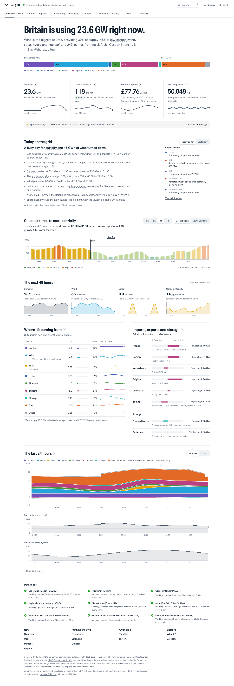

<sub>Screenshots use sample data.</sub>

## What it shows

| Page | Path | In short |
|---|---|---|
| Overview | `/` | What Britain is using now, where it comes from, today in plain English and the next 48 hours |
| Map and Stations | `/map`, `/stations` | Every power station and interconnector, live, with a seven-day time machine |
| Regions | `/regions` | Carbon intensity across NESO's 14 regions, a day back to two days ahead |
| Your home | `/home` | Your own electricity and gas from an Octopus smart meter, with carbon and cost (optional) |
| Frequency | `/frequency` | Live frequency, inertia, the response NESO holds, and sudden dips |
| Balancing | `/balancing` | Who NESO is paying to turn up or down, and what it costs |
| Constraints | `/constraints` | Where the network runs out of room, the wind turned down, and what it costs |
| Gas | `/gas` | Where Britain's gas comes from and goes, how much is in the pipes, and the wholesale price |
| Outages | `/outages` | Spare capacity, offline units and grid notices |
| Timeline | `/timeline` | Notable moments, kept for a year, linked to the map and History |
| History | `/history` | The mix, carbon and price since 2009, with records |
| Forecasts | `/forecasts` | How close NESO's wind, demand, carbon and solar forecasts came, and whether they're getting better |
| Year in review | `/review` | The grid's year and your home's, saved for good once the year is over |
| What if? | `/sandbox` | Trip a power station and watch the first minute and the next hour |
| Glossary | `/glossary` | Every term the dashboard uses, in plain English |
| Display | `/display` | A full-screen slideshow for a spare screen |

**Getting around.** On a computer the pages sit in a bar along the top,
grouped as Now, Running the grid, Over time and Explore; the bar stays
pinned as you scroll. On a phone they're in the Menu, with a line on what
each page shows. Press `/` or `⌘K` (`Ctrl+K` on Windows) anywhere to search
the pages, power stations by name, and glossary terms. The site is light by
default; the theme
button switches to dark or to match your device, and remembers the choice.

### Overview

What Britain is using right now and where it comes from: generation mix,
demand, carbon intensity, wholesale price, grid frequency, spare capacity and
interconnector and storage flows. Below that are history charts (24 hours and
7 days, plus 30 days if `HISTORY_DAYS` is 30 or more), the cleanest times to
use electricity over the next day for Great Britain or one of NESO's regions,
and forecasts of demand, wind, solar and carbon intensity for the next 48
hours.

Under the headline figures, **Today on the grid** summarises the day so far
(or yesterday) in a few sentences written from the data: the mix, carbon,
demand, prices, peaks, imports, balancing costs and any notices, led by
whatever was most notable. Beside it, the latest few events from the
Timeline.

### Map and Stations

Every grid-connected power station as a circle sized by what it's generating
and coloured by fuel, plus the interconnectors to Europe and Ireland with their
live flows. Zoom, pan, full screen, and a 24-hour history for any station. The
time machine along the bottom replays the last seven days in 10-minute steps.

Select a station for its card: a photo from Wikimedia Commons with its
photographer and licence (131 stations so far, including every nuclear and
pumped storage station and most of the big gas and hydro ones), or a small
locator map where there isn't one; its GPS coordinates and Ordnance Survey grid
reference; and links to open it in Google Maps, Apple Maps or OpenStreetMap.
`/map?station=<id>` and `/stations?station=<id>` open a station's card
directly.

Every station also has its own page (`/station?id=<id>`), reached from its
card, from search, or from an outage on the Timeline. It shows what the
station is generating now against its capacity; its output over the last 24
hours or 7 days with the energy generated, capacity factor, highest output
and share of time running; each of its generating units; its unplanned
outages and any frequency events they set off; and what's known about it:
year opened, owner and operator (from Wikidata, so sometimes behind a sale),
turbine numbers and sizes for wind farms (from the Renewable Energy Planning
Database), a Wikipedia link and the nearest other stations.

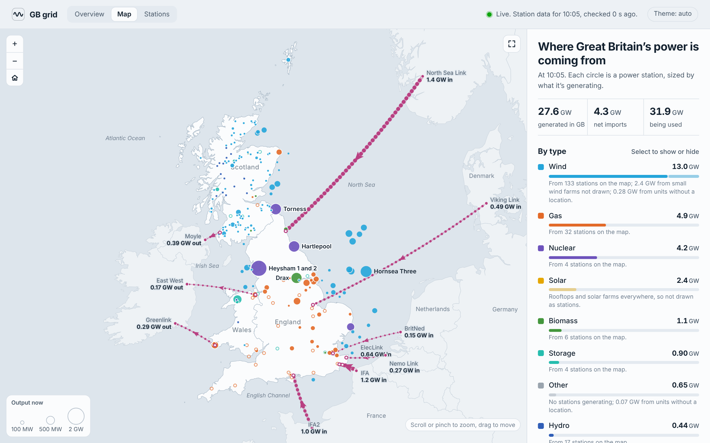

Stations shows the same data as tables: output by nation and by fuel, every
station with its capacity and how hard it's running, the interconnectors, and
any units that couldn't be placed on the map.

### Regions

NESO's 14 regions coloured by carbon intensity, from 24 hours ago to 48 hours
ahead, with each region's generation mix and solar output.

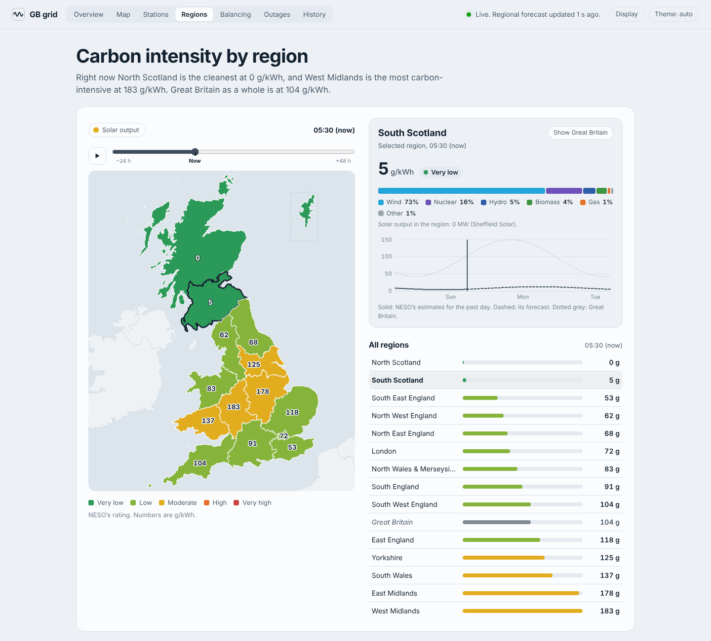

### Your home (optional)

If you're with Octopus Energy and have a smart meter, the dashboard can show
your own use alongside the grid's. Off unless set up; see
[Your home settings](#your-home-octopus-energy).

- **Now:** what your home is drawing, from an Octopus Home Mini, and what that
  means in CO₂ an hour at the grid's current carbon intensity, with the last
  hour, 6 hours or 24 hours of readings. The server keeps a day of the Home
  Mini's 10-second readings, so the longer views cost no extra requests.
- **Today:** each half hour's use coloured by how clean the grid was, with
  the forecast for the rest of the day, and today's carbon and cost so far.
- **The last 30 days:** carbon, energy or cost each day, electricity and gas.
- **When you use electricity:** the carbon intensity of the electricity you
  actually used, against steady use around the clock, which shows whether
  your timing helps.
- **What other tariffs would have cost:** your last 12 months of half-hourly
  use priced on Flexible Octopus, Agile Octopus and Octopus Go, and on
  today's Octopus 12M Fixed as a guide to renewing, for your region, against
  what you paid; month by month for any of them. The prices come from
  Octopus's public price list, so they don't use your account's requests.
- **Saving Sessions:** your Octoplus points, upcoming sessions with your
  baseline (worked out Octopus's way, from the same half hours on the previous
  10 weekdays), a reminder under the live figure the day before, and how you
  did in recent sessions.
- **Month by month** for the last year.

Electricity's carbon uses GB's carbon intensity for each half hour; gas uses
the UK government's conversion factor. Costs use your tariff's published unit
rates and standing charges, so they're close to your bill rather than exact.

### Frequency

The grid's frequency live against its limits, as an hour, six hours, a day or
a week of Elexon's 15-second readings. Below that: how steady it's been today
and how the readings spread around 50 Hz, NESO's estimate of the grid's
inertia, and how much fast frequency response (Dynamic Containment,
Moderation and Regulation) and quick reserve NESO is holding for the current
four-hour block. NESO publishes its inertia estimates in batches, often
months after the fact, so that panel shows the latest week available.

Sudden falls and rises are picked out as **frequency events**, usually a power
station or interconnector tripping. Each one shows the minutes around it, how
far and how fast frequency moved, how long it took to recover, the likely cause
(an unplanned outage notice or an interconnector's flow dropping at the same
moment) and the response NESO held at the time.

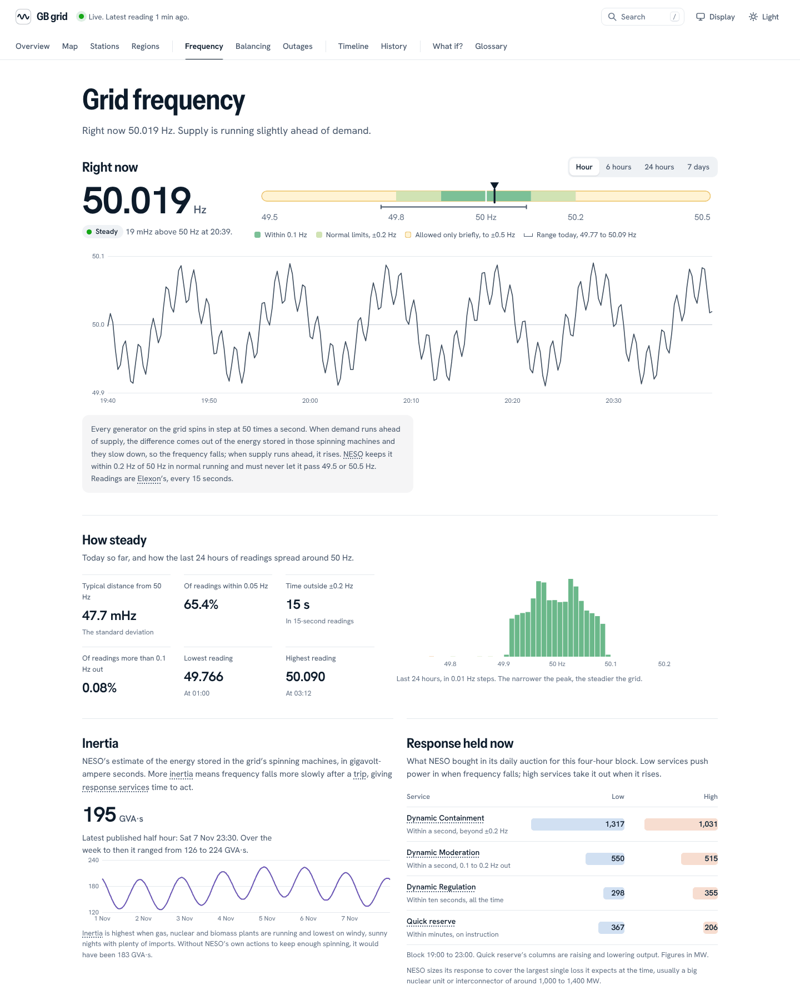

### Balancing

Who the grid operator is paying to switch off or turn up right now, what each
half hour of balancing cost today and yesterday, including NESO's trades
outside the Balancing Mechanism (mostly across the interconnectors), the
imbalance price each half hour against the market price, whether the system
was short or long, the units paid the most, and daily constraint costs.

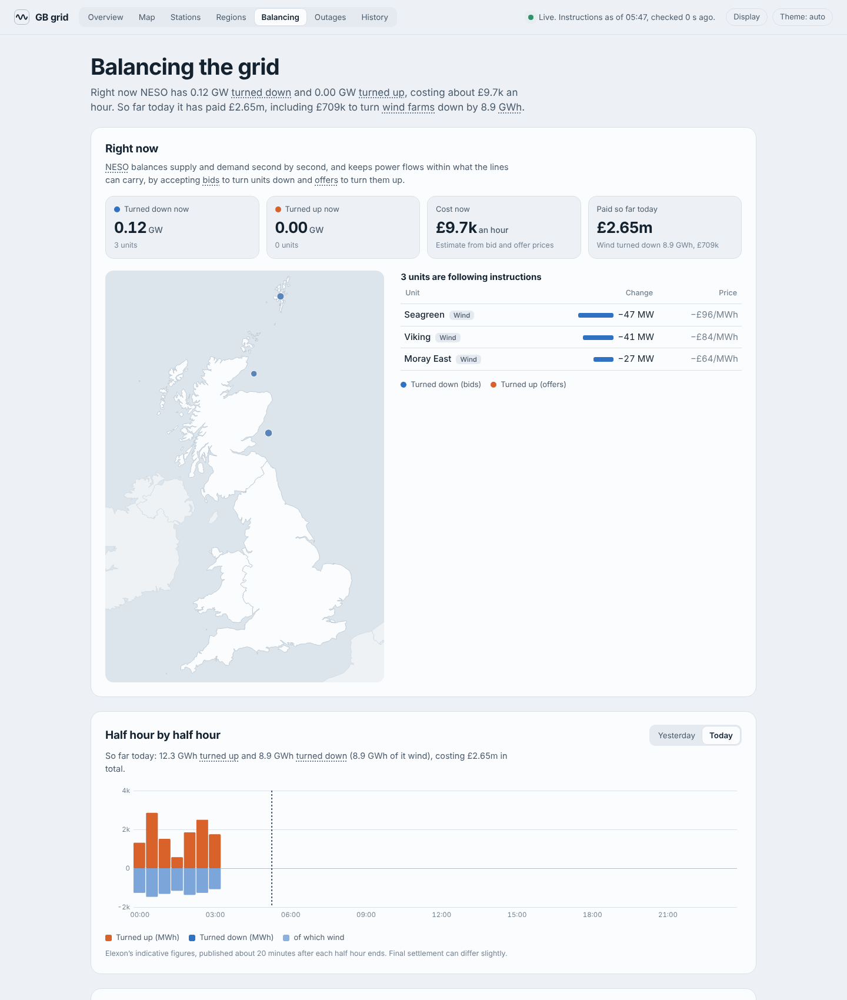

### Constraints

Why Scottish wind gets turned down. NESO's day-ahead forecast of the flow
across each transmission boundary against its limit, today and tomorrow,
with B4 (the north of Scotland to the Central Belt) and B6 (Scotland to
England) drawn on a map; any boundary's flow and limit, half hour by half
hour, for the last week and tomorrow; the wind farms paid to turn down, day
by day and farm by farm, and what share of wind's output that was; and what
constraints cost each day, by reason and by boundary, for the last year.
Everything comes from NESO's open data, with no key. It also has a slide on
the Display.

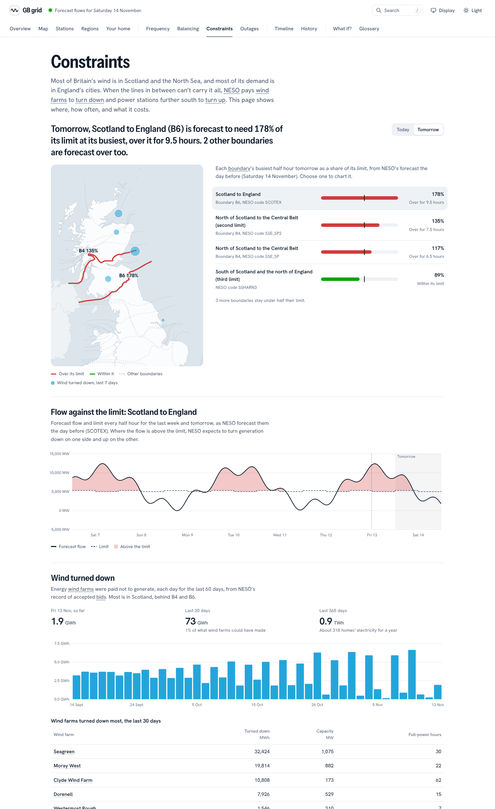

### Gas

Gas still makes about a quarter of Britain's electricity, so the gas system
is part of the picture. From National Gas's open data, with no key: what's
coming in now and from where (Norway through Langeled, the North Sea, LNG
shipped to Grain and Milford Haven, the continent and storage) and where it's
going (local networks, power stations, industry, exports and storage), every
five minutes; the gas day so far, from 05:00, with linepack (the gas in the
pipes) against National Gas's prediction for where it will close; a rough
efficiency for gas power stations, from the gas they take and the
electricity they make; and the last year's daily use and supply, and the
System Average Price, against your own gas unit rate if
[Octopus is set up](#your-home-octopus-energy). It also has a slide on the
Display.

National Gas turns away clients that ask too often, so the dashboard asks
for flows every five minutes and daily figures every three hours, downloads
the year once at 20 seconds a request, and stops for half an hour if it's
ever refused.

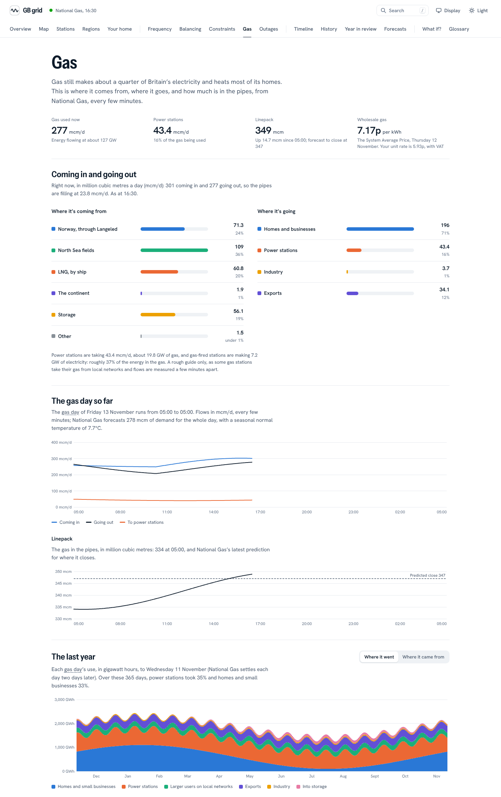

### Outages

Spare capacity over the next 12 hours, the big units that are offline and when
they're due back, the nuclear fleet, and NESO's grid notices. A banner appears
on every page while a margin notice or similar warning is in force.

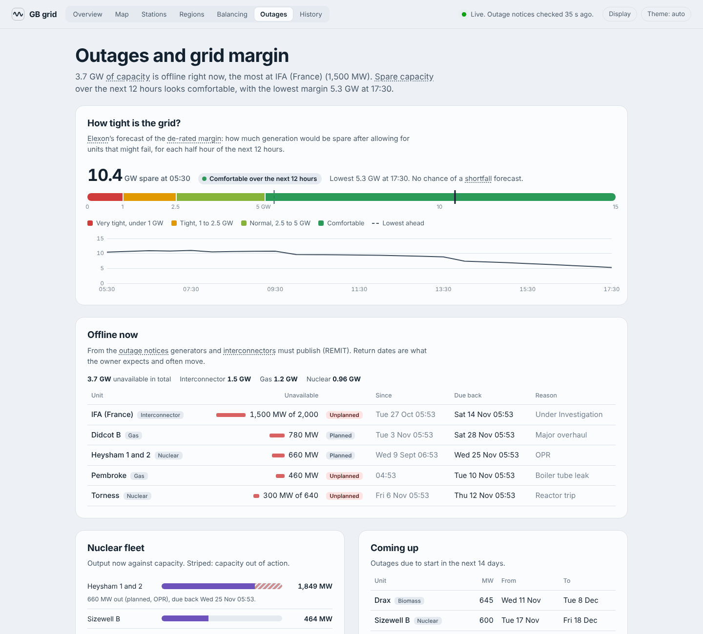

### Timeline

Notable moments, spotted in the data as they happen and kept for a year:
frequency events, large unplanned outages, negative prices and price spikes,
grid notices, new records in NESO's history since 2009, expensive constraint
days, and daily markers such as the demand peak and the first half hour that
wind supplied over half of Britain's electricity. Filter by kind; anything from
the last week opens on the map's time machine at that moment (`/map?at=` takes
any Unix time), and older moments open History zoomed to that week
(`/history?at=`). The Overview lists the latest few next to Today on the grid.

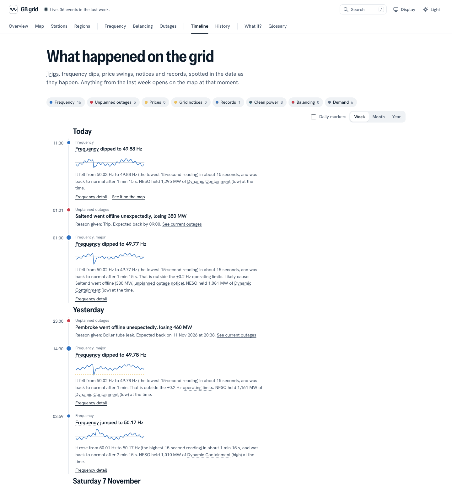

The same moments can be pushed to your phone or another system as they
happen: see [Notifications](#notifications).

### History

The generation mix, carbon intensity and wholesale price since 2009 (prices
since 2018), zoomable down to the half hour, plus records, the latest day
against a year earlier, and each year's mix. The full record downloads in the
background on first start; see `LONG_HISTORY` below.

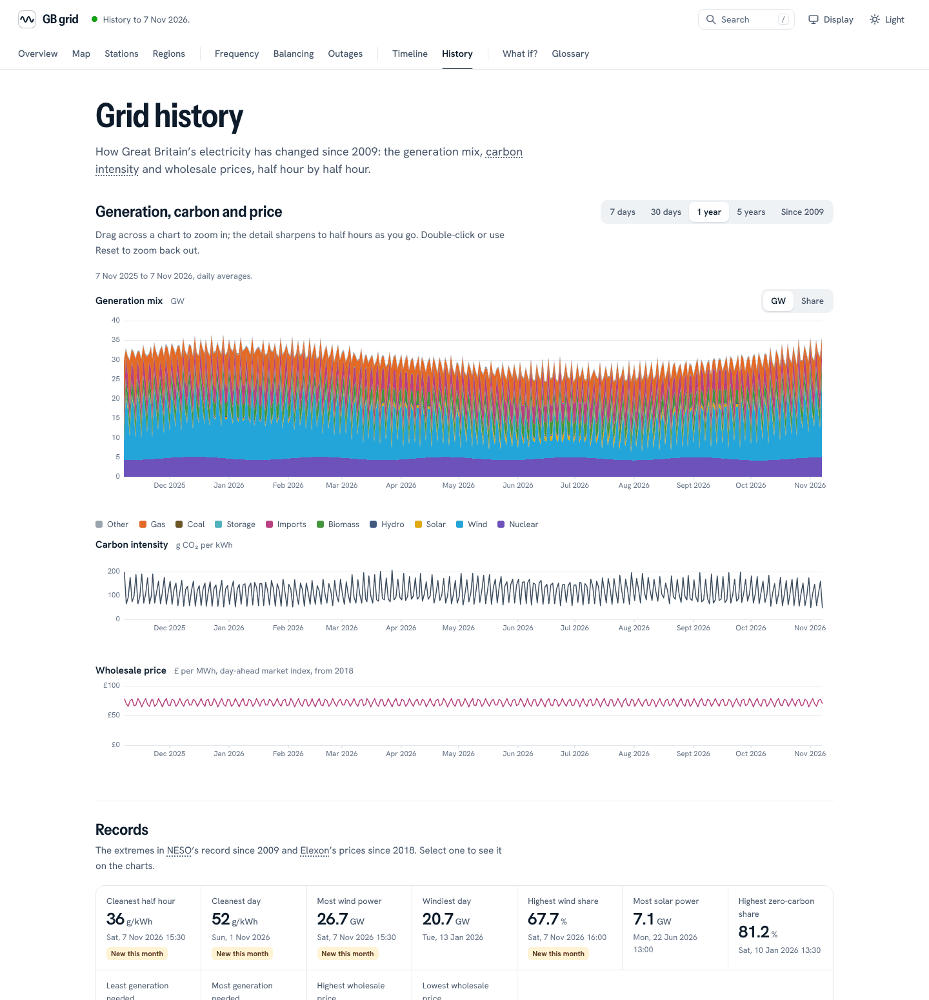

### Forecasts

How good NESO's forecasts are. The latest day of each against what
happened; a scorecard of typical misses and leans for the last 30 days
against a year earlier, with the worst day of the last year; and each
month's typical miss since the records began. Wind and demand, the day
before, come from NESO's own records back to 2018 and 2021; wind is scored
against what wind farms made plus what they were paid to turn down, so a
constraint isn't counted as a miss. NESO doesn't publish its day-before
carbon intensity and solar forecasts with what followed, so the dashboard
keeps them: each half hour's forecast as it stood at noon the day before,
scored once the half hour is over.

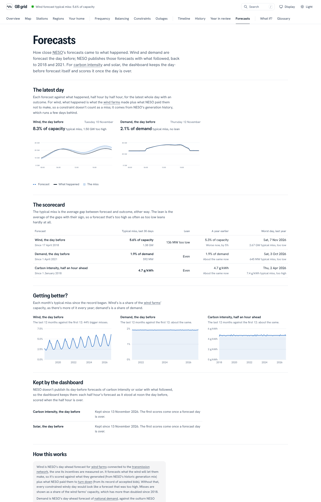

### Year in review

A calendar year on one page, worth keeping: carbon intensity every year
since 2009 with this one picked out; the year's figures against the year
before (the same days of it, while the year is still going); the mix for
the year and month by month; the year's highs and lows, marked where
they're the highest or lowest since 2009; wind and the wind turned down,
with constraint costs; the timeline's major moments; and, with
[Octopus set up](#your-home-octopus-energy), your home's year: electricity,
gas, cost and carbon by month, how your timing compared with using
electricity evenly, and your Saving Sessions. It makes no requests of its
own, to Octopus or anyone else. Pick any year since 2009; until the middle
of January it opens on the year just finished. Two weeks after a year ends,
the page is saved as it stands, so it reads the same after the timeline and
NESO's data have moved on. It prints, or saves as a PDF, without the site
around it, and from 15 December to the end of January it's also a slide on
the Display.

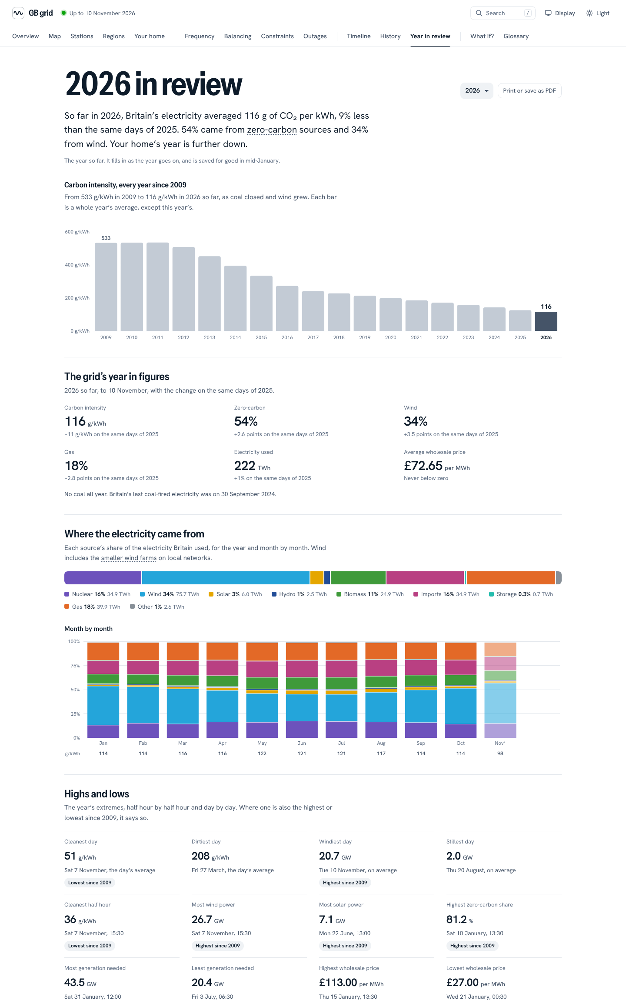

### What if?

A sandbox for seeing how the pieces fit. **The first minute** simulates a
trip: frequency falls at a rate set by the size of the loss and the inertia,
then demand easing off, Dynamic Containment, Moderation and Regulation,
generators' governors and reserve close the gap on their typical curves and
delays. Old loss-of-mains protection on small generators and automatic
demand disconnection at 48.8 Hz are modelled too. Start from the grid now
(inertia estimated from the spinning generation), any moment the time
machine holds, or a preset such as a double trip shaped like 9 August 2019.

**The next hour** is a simplified merit order: every source as a block of
megawatts at its running cost, from your gas, carbon and European prices.
Take a station or cable offline, change the wind or demand, and see the
price, who sets it, carbon intensity and the mix move. Both are one-node
teaching models, not studies of the real system.

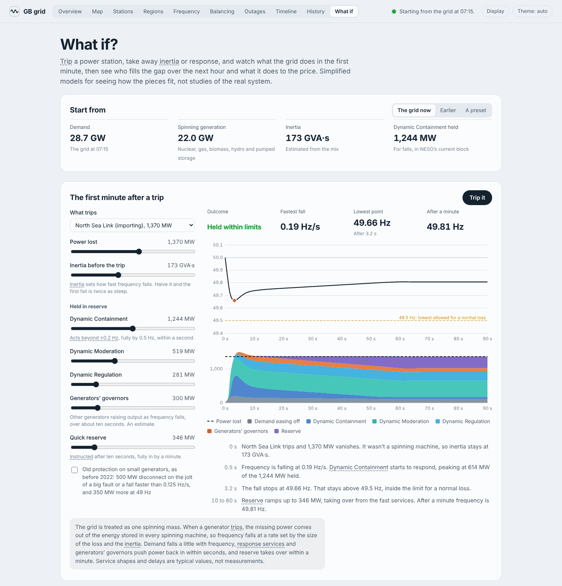

### Plain English throughout

Grid jargon in the explanations is underlined: hover, tap or tab to it for a
short definition. The Glossary page (`/glossary`, linked from the foot of every
page) lists all of them, grouped and searchable, with links to where each one
shows up in the dashboard.

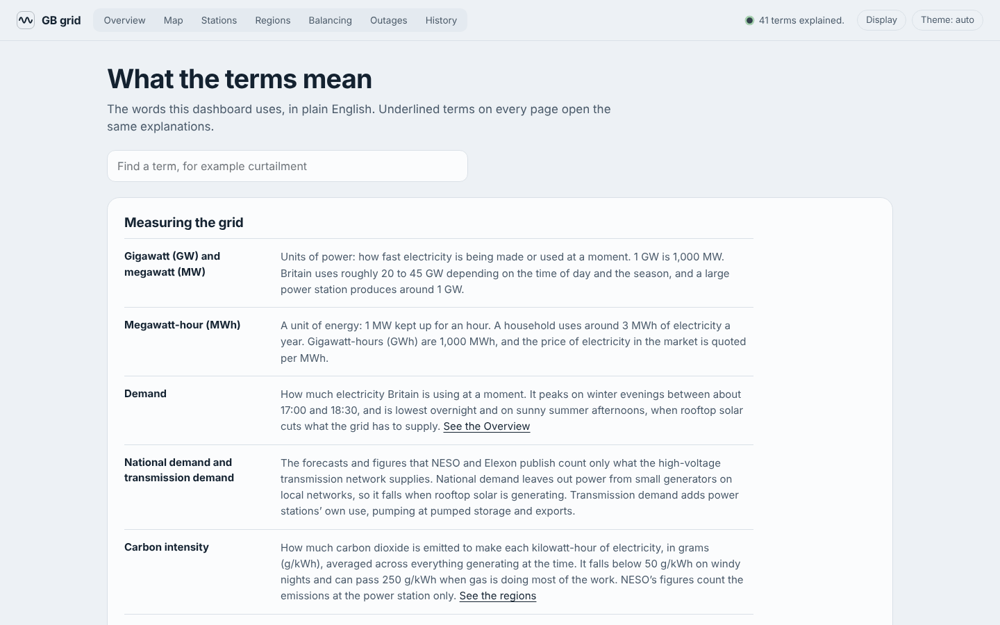

### Display

A kiosk view for a tablet or spare screen, opened from the Display button in
the header. Each slide is designed to fit one screen with nothing cut off:
right now, Today on the grid, the last 24 hours, the station map, regions,
balancing, constraints, gas, the next 48 hours, spare capacity and outages, and then and now
(once the history has downloaded). Tap to pause, swipe or use the arrow keys to
move on, and it dims to a clock overnight. On an iPad, add it to the home
screen for a full-screen app; it keeps the screen awake where the browser
allows.

| | |
|---|---|
| 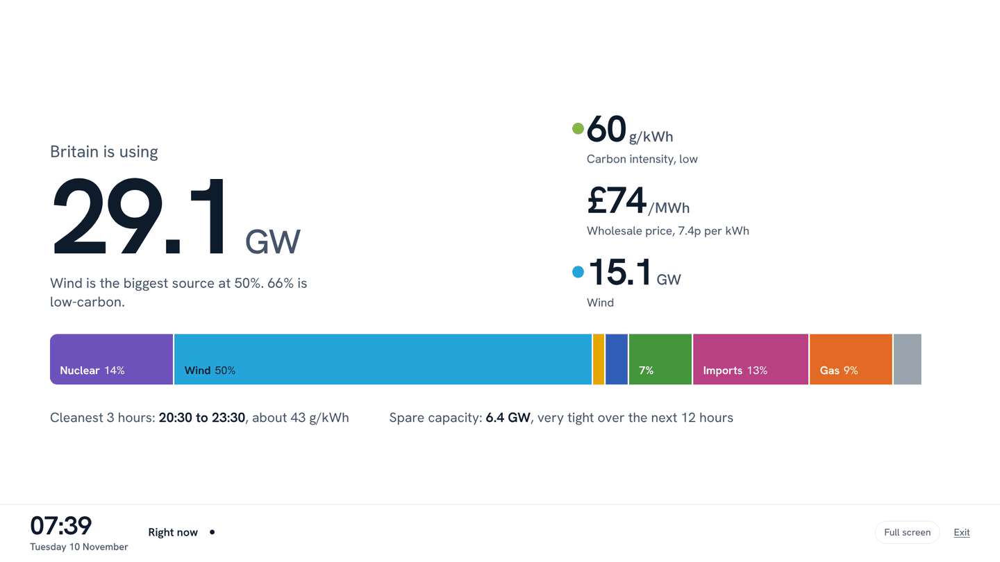 | 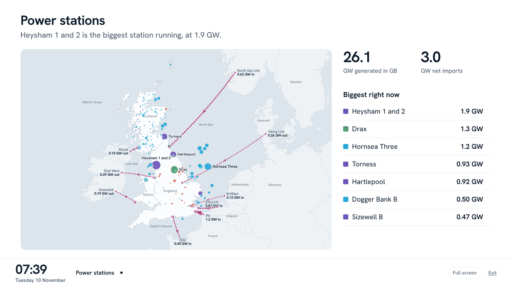 |
| 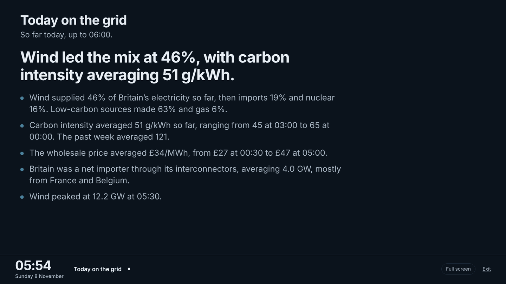 | 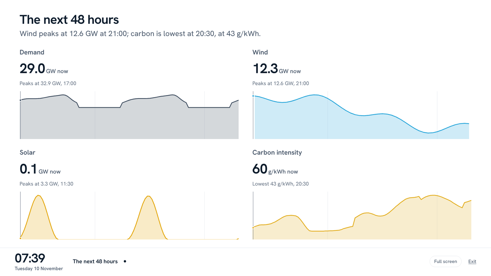 |

Options go in the address:
`/display?views=now,home,story,day,map,regions,balancing,constraints,gas,outlook,outages,records`
(which slides, in order; `home`, Your home, only shows when
[Octopus is set up](#your-home-octopus-energy); `review`, the year in review,
joins the default list from 15 December to the end of January), `every=20` (seconds per slide), `night=23-7` (dim
hours, UK time, or `night=off`) and `theme=dark` or `theme=light`.

## Quick start

```sh
mkdir gb-grid && cd gb-grid
curl -fsSLO https://raw.githubusercontent.com/rorymarland/gb-grid/main/docker-compose.yml
curl -fsSL -o .env https://raw.githubusercontent.com/rorymarland/gb-grid/main/.env.example  # optional
docker compose up -d
```

Then open `http://<host>:8080`. Live data appears within a minute, and history
downloads in the background (a couple of minutes for 30 days).

On NAS and Docker front ends (Synology Container Manager, Portainer, TrueNAS and
similar), create a project or stack from `docker-compose.yml` and put `.env`
alongside it if you want to change any settings.

### Image tags

Images are published for `linux/amd64` and `linux/arm64` to
`ghcr.io/rorymarland/gb-grid`.

| Tag | What it follows |
|---|---|
| `1` | The latest 1.x release (recommended) |
| `1.4.0` | That exact release |
| `latest` | The main branch |

To update: `docker compose pull && docker compose up -d`.

## Configuration

Settings are environment variables, normally set in `.env`. Every one has a
default; [`.env.example`](.env.example) explains each in more detail.

| Variable | Default | What it does |
|---|---|---|
| `GRID_PORT` | `8080` | Port on the host for the dashboard |
| `TZ` | `Europe/London` | Time zone for log timestamps (the pages always show UK time) |
| `CARBON_REGION_ID` | `0` | NESO region for the regional carbon view (1 to 17), or 0 for none |
| `HISTORY_DAYS` | `7` | Days of history to download and keep (2 to 60) |
| `BROWSER_REFRESH_SECONDS` | `10` | How often open pages check for new data |
| `LONG_HISTORY` | `true` | Download NESO's record since 2009 for the History page (about 20 MB) |
| `STATION_PHOTOS` | `true` | Show station photos from Wikimedia Commons (fetched by the server, kept in `/data`) |
| `NOTIFY_NTFY_URL` | (off) | An [ntfy](https://ntfy.sh/) topic address to push timeline events to; see [Notifications](#notifications) |
| `NOTIFY_WEBHOOK_URL` | (off) | An address that receives each event as a JSON POST |
| `NOTIFY_LEVEL` | `major` | `major`, `notable` or `all` |
| `NOTIFY_KINDS` | every kind | Any of `frequency,outage,price,notice,record,clean,demand,balancing` |
| `NOTIFY_QUIET_HOURS` | (none) | UK-time hours to send nothing in, such as `23:00-07:00` |
| `NOTIFY_NTFY_TOKEN` | (none) | Access token, if your ntfy topic needs one |
| `OCTOPUS_API_KEY` | (off) | Your Octopus Energy API key, for [Your home](#your-home-octopus-energy). A secret: keep it in `.env` or a Docker secret |
| `OCTOPUS_API_KEY_FILE` | (none) | Read the key from this file instead, such as a Docker secret at `/run/secrets/octopus_api_key` |
| `OCTOPUS_ACCOUNT` | (none) | Your Octopus account number, such as `A-1234ABCD` |
| `OCTOPUS_LIVE_SECONDS` | `60` | How often live readings are fetched while the Your home page is open (30 to 600) |
| `GAS_CALORIFIC_VALUE` | `39.5` | For gas meters that report cubic metres: the calorific value on your bill, in MJ/m³ |
| `GAS_KG_CO2_PER_KWH` | `0.183` | Carbon factor for burning gas |
| `PUBLIC_URL` | (none) | This site's address, such as `http://nas.local:8080`, so notifications link to the event |
| `POLL_*_SECONDS` | varies | How often each upstream source is polled (`POLL_CONSTRAINTS_SECONDS`, every 3 hours by default, for the Constraints page; `POLL_FORECASTS_SECONDS`, every 30 minutes, for the forecasts the dashboard keeps, with NESO's records checked every 6 hours; `POLL_IMBALANCE_SECONDS`, every 15 minutes, for imbalance prices, trades and temperature; `POLL_GAS_SECONDS`, every 5 minutes, for National Gas's flows) |
| `LOG_LEVEL` | `INFO` | `DEBUG` logs every poll |
| `ACCESS_LOG` | `false` | Log every HTTP request |

Data is kept in a SQLite database in the `/data` volume. Everything in it can be
downloaded again, so deleting the volume only costs the history download on
the next start. The container runs as UID 10001; if you bind-mount a host
folder instead of using a named volume, make it writable by that user.

### Notifications

The server can tell you when something notable happens on the grid: a large
power station tripping, a frequency excursion, negative prices, a grid notice
or a new record. It sends each new [Timeline](#timeline) event once, within a
couple of minutes of spotting it.

- **ntfy** (phone notifications): install the [ntfy](https://ntfy.sh/) app,
  subscribe to a topic with a name nobody would guess, and set
  `NOTIFY_NTFY_URL=https://ntfy.sh/<your-topic>`. A self-hosted ntfy server
  works the same way (`http://nas.local:8090/<topic>`); set
  `NOTIFY_NTFY_TOKEN` if the topic needs a token. Major events arrive as high
  priority, and tapping one opens the event if `PUBLIC_URL` is set.
- **Webhook** (Home Assistant, Node-RED, Slack-style relays and so on): set
  `NOTIFY_WEBHOOK_URL`. Each event is a JSON POST with `id`, `time`, `kind`,
  `level`, `title`, `message`, `url` and the event's `data` (for an outage,
  the station and megawatts lost; for a frequency event, the low point and
  recovery time).

By default only major events are sent, which is a few a week: a loss of
1,000 MW or more, frequency outside its operating limits, and the like.
`NOTIFY_LEVEL=notable` adds smaller trips, price swings and notices (several
a day); `all` adds the daily markers. `NOTIFY_KINDS` narrows it to the kinds
you care about, and `NOTIFY_QUIET_HOURS` keeps the night quiet: events in
those hours are not sent later. Events already old when first seen (after a
restart or a backfill) are never sent: two hours for things that happen
live, three days for records and costs, which are only published afterwards.
Turning notifications on doesn't replay the past.

To check it works:

```sh
docker compose exec gb-grid python /app/server.py --test-notification
```

`/api/status` reports the channels in use, how many have been sent, the last
one and the last error. With ntfy.sh, the topic name is the only secret and
the messages pass through their servers; use your own ntfy server or a
webhook to keep everything on your network.

### Your home (Octopus Energy)

1. Find your API key and account number on your Octopus account page, under
   **Personal details** and then **API access**.
2. Add them to the `.env` file next to `docker-compose.yml`:

   ```sh
   OCTOPUS_API_KEY=sk_live_...
   OCTOPUS_ACCOUNT=A-1234ABCD
   ```

3. Restart (`docker compose up -d`) and check it works:

   ```sh
   docker compose exec gb-grid python /app/server.py --test-octopus
   ```

   This confirms the key, lists your meters and tariffs (identifiers cut to
   their last four characters) and shows the latest Home Mini reading.

**Your home** then appears under Now in the menu, and fills in within a few
minutes: a year of half-hourly readings is downloaded on the first start.

**Keeping the key safe.** The key can read your account, including your
address and bills, so it never goes in the compose file, the repository or a
screenshot. `.env` is listed in `.gitignore`. A variable set from `.env` is
still visible to anyone who can run `docker inspect`; if that matters, keep
the key in a [Docker secret](https://docs.docker.com/compose/how-tos/use-secrets/)
instead:

```yaml
services:
  gb-grid:
    environment:
      OCTOPUS_API_KEY_FILE: /run/secrets/octopus_api_key
      OCTOPUS_ACCOUNT: ${OCTOPUS_ACCOUNT:-}
    secrets: [octopus_api_key]
secrets:
  octopus_api_key:
    file: ./octopus_api_key.txt   # one line: the key
```

Outside Swarm, Compose mounts the file as it is on the host, with its owner
and permissions, and the container runs as UID 10001. So let only that user
read it: `sudo chown 10001 octopus_api_key.txt && sudo chmod 400
octopus_api_key.txt`. If it can't be read, the log says so at start-up.

The server only sends the key to Octopus, never logs it or passes it to the
browser, and `/api/home` returns totals only (no account number, MPAN or
meter serials). Readings are kept in the `/data` volume.

**How often it asks Octopus.** Octopus allows about 100 requests an hour per
account, shared with its app and anything else using your key (Home
Assistant's Octopus integration, for one). This server makes about 17 an hour
in the background, about 62 while the Your home page is open (live readings
every minute) and about 34 while a [Display](#display) shows the Your home
slide (every two minutes). Other tariffs' prices come from Octopus's public
price list once a day and don't count. With other integrations polling too, raise
`OCTOPUS_LIVE_SECONDS`.

**Without a Home Mini**, there are no live readings: everything else works,
about a day behind. Gas meters only report through the meter's daily upload,
so gas is always a day or two behind. Tariffs with more than one rate (such
as Economy 7) show use and carbon but not cost.

### Behind a reverse proxy

Any reverse proxy works (Caddy, Traefik, Nginx, Nginx Proxy Manager and so on).
Proxy a whole host name, such as `grid.example.com`, to the container over plain
HTTP; serving it under a sub-path such as `/grid/` isn't supported. No websockets
are needed.

### Security

The dashboard has no login and serves plain HTTP, so keep it on your own
network: reach it from outside through a VPN such as Tailscale or WireGuard,
or a reverse proxy that adds TLS and authentication, rather than forwarding
the port. It only reads public data and holds no secrets.

- Images are rebuilt every Monday on a freshly pulled base image, for both
  `latest` and the latest release's tags, so Python and Alpine fixes arrive
  without a new release. Alpine packages are upgraded during the build.
- Each build is scanned with [Trivy](https://trivy.dev) and isn't published
  if it has a high or critical vulnerability with a fix available. Trivy
  can't see CPython itself (it's built from source in the base image), so
  Python's own security releases arrive through the weekly rebuild.
- The server closes connections that stay idle for 30 seconds and accepts at
  most 100 at once, so slow or stuck clients can't tie it up.
- Browsers only ever talk to your server. Station photos are fetched from
  Wikimedia Commons by the server, checked (JPEG, PNG or WebP, under 4 MB,
  redirects only to Wikimedia over HTTPS) and kept in `/data/photos`, so the
  pages' Content Security Policy still allows images from your server alone.
- Notifications are off unless you set an address for them, and go only to
  that address.
- The example compose file runs it read-only as an unprivileged user with no
  Linux capabilities. GitHub Actions are pinned to commit SHAs and kept up to
  date by Dependabot.

### DNS blocklists

Some DNS blocklists used with Pi-hole or AdGuard Home block whole top-level
domains, including `.energy`, which NESO uses for `api.neso.energy`. The
embedded wind and solar feeds then fail with "Connection refused", and
**Data sources** at the foot of every page names them as unavailable (open it
for the error).
Allowlist `api.neso.energy` to fix it.

## How the numbers are made

- **Generation by fuel** comes from Elexon's five-minute FUELINST data for
  transmission-connected generation, plus estimates of solar (Sheffield Solar
  PV_Live) and smaller wind farms (NESO) connected to local networks, so the
  totals cover what Britain actually uses.
- **Carbon intensity** comes from NESO's Carbon Intensity API. Regional figures
  describe the electricity used in that region, following power flows between
  regions, so a region that makes more wind, nuclear and hydro power than it
  uses (often the Scottish ones) can sit at 0 g/kWh for days.
- **Power stations** on the map are modelled, because there's no public live
  meter reading per station. Each unit's output comes from its Physical
  Notification (what it told the grid operator it would generate), overridden
  by any Bid-Offer Acceptances (the operator's instructions to change that).
  Each fuel's estimates are then scaled so they add up to Elexon's measured
  total for the same five minutes. Interconnector flows are measured.
- **Locations** come from Wikidata for the 143 stations matched there; from
  the government's Renewable Energy Planning Database (REPD), which has
  surveyed coordinates, for 64 onshore wind, biomass and battery sites
  Wikidata doesn't list; from the site a plant stands on for five gas
  plants; and from where their photo was taken for two wind farms. The
  remaining 32 use the Power Station Dictionary's location or one
  added by hand. (The dictionary's own locations are sometimes tens of
  kilometres out: it had Torness in the North Sea. REPD's can be too, so each
  onshore station is also checked against where its photo was taken.) Units that can't be matched still count in the totals; they're
  listed on the Stations page and logged once a day.
- **Frequency events** are found in Elexon's 15-second readings: a change of
  0.08 Hz or more within 30 seconds, or a crossing of 49.8 or 50.2 Hz. A trip
  pulls frequency to its lowest point within a few seconds, so the 15-second
  readings usually miss the true nadir and understate the fall. The cause is a
  best guess: an unplanned REMIT notice starting within ten minutes either
  side, or an interconnector's flow falling by 300 MW or more. Nobody
  publishes which units delivered response during an event, so the page shows
  what was held instead, from NESO's daily auction results.
- **The sandbox's inertia** is estimated from the synchronous generation
  running (nuclear, gas, biomass, hydro and pumped storage): a straight line
  fitted to NESO's published inertia against the historic mix once enough of
  both overlap, and about 6.5 GVA·s per GW plus 30 GVA·s until then. Its
  running costs are typical values, not bids: gas plants get an efficiency
  between 47% and 58% (33% to 38% for small open-cycle plant) and burn gas at
  the price you set, plus 0.184 tonnes of CO2 per MWh of gas at your carbon
  price.
- **Boundary flows** are NESO's day-ahead forecasts of what would flow if
  every unit ran as the market scheduled it; since April 2024 they leave out
  NESO's own constraint actions, so above 100% is where NESO expects to step
  in, not a flow that happened. NESO publishes groups by code without
  descriptions; the page names the ones whose meaning is clear and only
  links B4 and B6 to the map. **Wind turned down** is NESO's record of
  accepted bids from wind farms, in MW for each half hour, so each half
  hour's MWh is half the figure. Its share is the energy turned down over
  what transmission-connected wind farms made plus that, for the latest 30
  days NESO has both.
- **The year in review's carbon check:** each month's published intensity is
  compared with the intensity its mix implies (gas 394, coal 937, biomass 120
  and other 300 g/kWh; imports and zero-carbon sources as none), against how
  the two related over the 24 months before. A month more than 15% out of
  line is marked as suspect. The History page shows NESO's figures as
  published. The record since 2009 is read again for the last 400 days once
  a week, so NESO's revisions arrive.
- **Imbalance prices** are Elexon's system prices for each half hour (one
  price since 2015, so the buy and sell prices are the same), with the net
  imbalance volume: above zero the system was short and NESO bought energy,
  below zero long and it sold. Trades outside the Balancing Mechanism are
  Elexon's DISBSAD, added up each half hour: what NESO paid for energy it
  bought and received for energy it sold.
- **Temperature** is Elexon's daily average for Britain, with its reference
  normal for the date; its record starts in April 2021. It's shown with
  demand on the Forecasts page, and by month in the year in review.
- **Forecast misses:** the typical miss is the mean absolute error, the lean
  the mean signed error (forecast minus outcome). Wind's is shown as a share
  of the wind farms' capacity, from NESO's own forecast record; demand's as
  a share of demand. A day-before forecast kept by the dashboard only counts
  if it was taken within six hours of noon the day before.
- **Northern Ireland** is part of the all-island grid with Ireland rather than
  the GB grid, so it only appears through the Moyle interconnector.

## API

| Endpoint | Returns |
|---|---|
| `/api/live` | The current snapshot behind the overview |
| `/api/history?range=24h` | History series (`24h`, `7d` or `30d`) |
| `/api/map` | Stations, interconnectors and totals for the map |
| `/api/station?id=N` | One station's last 24 hours, and its location, Wikidata item and photo credit. Add `&full=1` for everything on the station page: the week, statistics, units, facts, events and neighbours |
| `/api/stations` | Every station's id, name and kind (used by search) |
| `/api/photo?id=N` | The station's photo (from Wikimedia Commons, cached by the server) |
| `/api/replay` | The last seven days of the map in 10-minute frames |
| `/api/regions` | Every region's carbon intensity, mix and solar, 24 hours back to 48 ahead |
| `/api/balancing` | Live instructions, half-hourly costs, top payments, constraint costs, and imbalance prices and trades for today and yesterday |
| `/api/constraints?group=SCOTEX` | Today's and tomorrow's boundary flows against their limits, one group's half hours for the chart (`group=`), each group's last 30 and 365 days, constraint costs by reason, and wind turned down by day and wind farm |
| `/api/gas` | Gas now: supply by source, use by category and every entry point; the gas day's flows and linepack with National Gas's predicted close and demand forecast; power stations' gas against gas-fired generation; and a year of daily allocations (GWh) and the System Average Price |
| `/boundaries.json` | The ETYS transmission boundaries as map paths |
| `/api/outages` | Margin forecast, offline units, nuclear fleet, upcoming outages and notices |
| `/api/alerts` | Grid notices in force and the margin summary (drives the banner) |
| `/api/longterm?from=&to=` | Mix, carbon and price between two Unix times, averaged to suit the span |
| `/api/longterm/summary` | Records, the year-apart comparison and yearly mix |
| `/api/outlook` | Demand, wind, solar and carbon forecasts for the next 48 hours |
| `/api/summary?day=today` | Today on the grid (or `yesterday`), as text parts with glossary terms marked |
| `/api/frequency?range=1h` | Frequency readings (`1h`, `6h`, `24h`, or `7d` in five-minute buckets), today's figures, inertia, response held and recent frequency events; `&event=<id>` adds one event in full |
| `/api/events?days=30` | The timeline, newest first, with counts by kind; `&kind=frequency,outage` to filter |
| `/api/sandbox?at=` | Starting figures for the sandbox: response held at that moment and the inertia fit |
| `/api/forecasts` | Each forecast's latest day, last 30 days, a year earlier, months since its record began and worst days |
| `/api/review?year=2026` | The year in review: the grid's year (figures, the year before, months, highs and lows, constraints, moments, every year since 2009) and your home's (`null` without Octopus). Without `year`, the year just finished until mid-January, then this one |
| `/api/home` | Your home: live reading, today's half hours, the last 30 days, months and timing (`{"enabled": false}` when Octopus isn't set up) |
| `/api/status` | 200 when generation data is fresh, otherwise 503 (handy for uptime monitors) |
| `/healthz` | 200 when the server is running |

## Development

Python 3.11 or newer, with no packages to install. `test/mock_upstream.py`
serves fake versions of every upstream API, so you can work offline:

```sh
python3 test/mock_upstream.py 9101 app &
DATA_DIR=./data CARBON_REGION_ID=2 \
ELEXON_BASE_URL=http://127.0.0.1:9101/bmrs/api/v1 \
CARBON_BASE_URL=http://127.0.0.1:9101/carbon \
PVLIVE_BASE_URL=http://127.0.0.1:9101/pvlive/api/v4 \
NESO_BASE_URL=http://127.0.0.1:9101/neso \
NATIONAL_GAS_BASE_URL=http://127.0.0.1:9101/gas \
GRID_INTERNAL_PORT=8080 python3 app/server.py
```

Add `UI_RELOAD=1` to reread the pages and static files on every request while
you edit them.

Run the tests with `python3 test/test_units.py`, `python3 test/test_time.py`,
`python3 test/test_edges.py` and `python3 test/test_features.py`, and each
feed's own (`test/test_constraints.py`, `test_review.py`, `test_forecasts.py`,
`test_imbalance.py` and `test_gas.py`).

### How the code is laid out

| Where | What |
|---|---|
| `app/server.py` | Starts the dashboard |
| `app/gridlive/` | The server: `config`, `fetch` and `store`; one module per feed (`ingest`, `units`, `balancing`, `constraints`, `gas`, `review`, `forecasts`, `outages`, `longterm`, `notices`, `frequency`, and `home` with `octopus`, `home_sessions` and `home_views`); `events` for the timeline's detectors; the API payloads (`grid` and `views_*`, including `views_summary` for Today on the grid and `views_events` for the timeline and frequency); the HTTP server (`web`) |
| `app/*.html` | Short page shells; the server fills in the shared head, header and credits |
| `app/static/js/` | Shared ES modules: `gb.js` (DOM, formatting, tooltips, polling, theme, menus, search and warning banner), `glossary.js` (the terms and their popovers), `summary.js`, `gridsim.js` and `meritorder.js` (the sandbox's models), `charts.js`, `stationmap.js`, `stationcard.js` and `osgrid.js` (the station card and its OS grid references), `regionmap.js`, `outlook.js` |
| `app/static/pages/` | Each page's own script and styles |
| `app/static/vendor/` | uPlot, served from the image |
| `app/static/fonts/` | Hanken Grotesk and Instrument Sans, with their licences |

No build step: the browser loads the modules directly, and an import map in
each page adds a version to every module's address so they can be cached. Pushes to `main` and version tags (`v1.2.3`) run
the tests, smoke-test the image and publish it.

To make a release, add its notes to [CHANGELOG.md](CHANGELOG.md), then create a
GitHub release with a new `vX.Y.Z` tag on `main`. A fork publishes to its own
`ghcr.io/<owner>/gb-grid`, which GitHub creates as private: make it public in the
package's settings to pull it without logging in.

### Rebuilding the station list and map outlines

`app/stations.csv` and `app/geo.json` are generated by the scripts in `tools/`:

```sh
git clone --depth 1 https://github.com/OSUKED/Power-Station-Dictionary /tmp/psd
curl -fsSL -o /tmp/units.geojson \
  https://raw.githubusercontent.com/nvkelso/natural-earth-vector/master/geojson/ne_10m_admin_0_map_units.geojson
python3 -I tools/build_geo.py /tmp/units.geojson
python3 -I tools/build_stations.py /tmp/psd/data /tmp/units.geojson
```

To add a missing station, add it to `MANUAL` in `tools/build_stations.py` with
its BM unit IDs, ID prefixes or a pattern matching its registered name, then
rebuild.

`app/station_wikidata.csv` holds each station's better location and its
photo. It's built by `tools/build_photos.py`, run by the **Build station
photos** workflow in GitHub Actions (Wikimedia and gov.uk aren't reachable
from everywhere). Locations come from Wikidata, then REPD, then the site a
plant stands on; photos from the Wikidata item or chosen by eye from Commons.
The workflow prints a report and contact sheets of every photo to its log for
review. The report lists every match, each location change, and any onshore
station more than 8 km from where its own photo was taken. Decisions from
that review (wrong matches, photos that show the wrong thing, REPD points
that are wrong) are recorded in the tables at the top of the script. Copy the
CSV into `app/`, then rebuild `stations.csv` so it picks up the locations.

Two more tools help: the **Explore station sources** workflow
(`tools/explore_stations.py`) searches Wikidata, REPD and Commons for
stations without a match and prints contact sheets of candidate photos to
choose from; and `tools/check_locations.py` checks `stations.csv` against the
map's coastline (onshore stations in the sea, offshore wind farms on land,
stations sharing coordinates). The tests run it.

## Credits and licences

- Contains BMRS data © Elexon Limited copyright and database right 2026
  ([licence](https://www.elexon.co.uk/data/balancing-mechanism-reporting-agent/copyright-licence-bmrs-data/)).
- Supported by National Energy SO Open Data
  ([licence](https://www.neso.energy/data-portal/neso-open-licence)): carbon
  intensity from the [NESO Carbon Intensity API](https://carbonintensity.org.uk/),
  and embedded generation, region boundaries, transmission boundaries, constraint flows, limits and costs, wind turned down, the historic
  generation mix, system inertia and frequency response auction results from
  the [NESO Data Portal](https://www.neso.energy/data-portal).
- Solar estimates from [Sheffield Solar PV_Live](https://www.solar.sheffield.ac.uk/pvlive/).
- Gas flows, linepack, allocations and prices from National Gas Transmission's
  [open data](https://data.nationalgas.com/), which it publishes under its gas
  system operator licence.
- Station locations from [Wikidata](https://www.wikidata.org/) (CC0) and the
  [Power Station Dictionary](https://github.com/OSUKED/Power-Station-Dictionary) (MIT),
  and the Department for Energy Security and Net Zero's
  [Renewable Energy Planning Database](https://www.gov.uk/government/publications/renewable-energy-planning-database-quarterly-extract)
  (contains public sector information licensed under the Open Government
  Licence v3.0).
- Station photos from [Wikimedia Commons](https://commons.wikimedia.org/),
  each under its own free licence (CC BY, CC BY-SA, CC0 or public domain) and
  credited with its photographer on the station card.
- Map outlines from [Natural Earth](https://www.naturalearthdata.com/) (public domain).
- Type is [Hanken Grotesk](https://github.com/marcologous/hanken-grotesk) and
  [Instrument Sans](https://github.com/Instrument/instrument-sans), both under
  the SIL Open Font Licence and served from your own server.
- Charts on the History page use [uPlot](https://github.com/leeoniya/uPlot) (MIT),
  served from the image rather than a CDN.
- Inspired by Kate Morley's [National Grid: Live](https://grid.iamkate.com/).

Live data is fetched from each source's public API and is subject to its terms.
This project isn't affiliated with or endorsed by Elexon, NESO or National Gas.

The code is released under the [MIT licence](LICENSE).
